# Star Tracker Report

**2026-11-27** | Total: **8638 stars** | Change: **+7**

> Compared to snapshot from 2026-11-26

## 📈 Star Trend

### By Repository

Individual Repository Charts

#### RapidAI/RapidOCR: 8638 ★ (+7)

## Repositories

| Repositories | Stars | Change | Trend |
|:-----------|------:|-------:|:-----:|
| [RapidAI/RapidOCR](https://github.com/RapidAI/RapidOCR) | 8638 | +7 | ⬆️ |

## Summary

- **Stars gained:** 7
- **Stars lost:** 0
- **Net change:** +7

## 🔮 Growth Forecast

**Aggregate Forecast**

| Method | Week 1 | Week 2 | Week 3 | Week 4 |
|:---|---:|---:|---:|---:|
| Linear Regression | 8664 | 8690 | 8716 | 8742 |
| Weighted Moving Average | 8678 | 8718 | 8758 | 8797 |

### By Repository

RapidAI/RapidOCR

**RapidAI/RapidOCR**

| Method | Week 1 | Week 2 | Week 3 | Week 4 |
|:---|---:|---:|---:|---:|
| Linear Regression | 8664 | 8690 | 8716 | 8742 |
| Weighted Moving Average | 8678 | 8718 | 8758 | 8797 |

---
*Generated by [GitHub Star Tracker](https://github.com/fbuireu/github-star-tracker) on 2026-11-27T05:53:19.533Z*

*Made with 🤘 by [Ferran Buireu](https://github.com/fbuireu)*

