# Star Tracker Report

**2026-11-26** | Total: **8631 stars** | Change: **+9**

> Compared to snapshot from 2026-11-25

## 📈 Star Trend

### By Repository

Individual Repository Charts

#### RapidAI/RapidOCR: 8631 ★ (+9)

## Repositories

| Repositories | Stars | Change | Trend |
|:-----------|------:|-------:|:-----:|
| [RapidAI/RapidOCR](https://github.com/RapidAI/RapidOCR) | 8631 | +9 | ⬆️ |

## Summary

- **Stars gained:** 9
- **Stars lost:** 0
- **Net change:** +9

## 🔮 Growth Forecast

**Aggregate Forecast**

| Method | Week 1 | Week 2 | Week 3 | Week 4 |
|:---|---:|---:|---:|---:|
| Linear Regression | 8657 | 8683 | 8709 | 8734 |
| Weighted Moving Average | 8671 | 8711 | 8751 | 8790 |

### By Repository

RapidAI/RapidOCR

**RapidAI/RapidOCR**

| Method | Week 1 | Week 2 | Week 3 | Week 4 |
|:---|---:|---:|---:|---:|
| Linear Regression | 8657 | 8683 | 8709 | 8734 |
| Weighted Moving Average | 8671 | 8711 | 8751 | 8790 |

---
*Generated by [GitHub Star Tracker](https://github.com/fbuireu/github-star-tracker) on 2026-11-26T05:59:31.669Z*

*Made with 🤘 by [Ferran Buireu](https://github.com/fbuireu)*

