# Star Tracker Report

**2026-11-18** | Total: **8562 stars** | Change: **+8**

> Compared to snapshot from 2026-11-17

## 📈 Star Trend

### By Repository

Individual Repository Charts

#### RapidAI/RapidOCR: 8562 ★ (+8)

## Repositories

| Repositories | Stars | Change | Trend |
|:-----------|------:|-------:|:-----:|
| [RapidAI/RapidOCR](https://github.com/RapidAI/RapidOCR) | 8562 | +8 | ⬆️ |

## Summary

- **Stars gained:** 8
- **Stars lost:** 0
- **Net change:** +8

## 🔮 Growth Forecast

**Aggregate Forecast**

| Method | Week 1 | Week 2 | Week 3 | Week 4 |
|:---|---:|---:|---:|---:|
| Linear Regression | 8588 | 8613 | 8639 | 8665 |
| Weighted Moving Average | 8602 | 8641 | 8681 | 8721 |

### By Repository

RapidAI/RapidOCR

**RapidAI/RapidOCR**

| Method | Week 1 | Week 2 | Week 3 | Week 4 |
|:---|---:|---:|---:|---:|
| Linear Regression | 8588 | 8613 | 8639 | 8665 |
| Weighted Moving Average | 8602 | 8641 | 8681 | 8721 |

---
*Generated by [GitHub Star Tracker](https://github.com/fbuireu/github-star-tracker) on 2026-11-18T05:10:37.687Z*

*Made with 🤘 by [Ferran Buireu](https://github.com/fbuireu)*

