# Star Tracker Report

**2026-10-26** | Total: **8312 stars** | Change: **+10**

> Compared to snapshot from 2026-10-25

## 📈 Star Trend

### By Repository

Individual Repository Charts

#### RapidAI/RapidOCR: 8312 ★ (+10)

## Repositories

| Repositories | Stars | Change | Trend |
|:-----------|------:|-------:|:-----:|
| [RapidAI/RapidOCR](https://github.com/RapidAI/RapidOCR) | 8312 | +10 | ⬆️ |

## Summary

- **Stars gained:** 10
- **Stars lost:** 0
- **Net change:** +10

## 🔮 Growth Forecast

**Aggregate Forecast**

| Method | Week 1 | Week 2 | Week 3 | Week 4 |
|:---|---:|---:|---:|---:|
| Linear Regression | 8337 | 8363 | 8388 | 8413 |
| Weighted Moving Average | 8351 | 8390 | 8429 | 8468 |

### By Repository

RapidAI/RapidOCR

**RapidAI/RapidOCR**

| Method | Week 1 | Week 2 | Week 3 | Week 4 |
|:---|---:|---:|---:|---:|
| Linear Regression | 8337 | 8363 | 8388 | 8413 |
| Weighted Moving Average | 8351 | 8390 | 8429 | 8468 |

---
*Generated by [GitHub Star Tracker](https://github.com/fbuireu/github-star-tracker) on 2026-10-26T02:21:01.017Z*

*Made with 🤘 by [Ferran Buireu](https://github.com/fbuireu)*

