# Star Tracker Report

**2026-11-28** | Total: **8649 stars** | Change: **+11**

> Compared to snapshot from 2026-11-27

## 📈 Star Trend

### By Repository

Individual Repository Charts

#### RapidAI/RapidOCR: 8649 ★ (+11)

## Repositories

| Repositories | Stars | Change | Trend |
|:-----------|------:|-------:|:-----:|
| [RapidAI/RapidOCR](https://github.com/RapidAI/RapidOCR) | 8649 | +11 | ⬆️ |

## Summary

- **Stars gained:** 11
- **Stars lost:** 0
- **Net change:** +11

## 🔮 Growth Forecast

**Aggregate Forecast**

| Method | Week 1 | Week 2 | Week 3 | Week 4 |
|:---|---:|---:|---:|---:|
| Linear Regression | 8675 | 8701 | 8727 | 8753 |
| Weighted Moving Average | 8689 | 8729 | 8769 | 8809 |

### By Repository

RapidAI/RapidOCR

**RapidAI/RapidOCR**

| Method | Week 1 | Week 2 | Week 3 | Week 4 |
|:---|---:|---:|---:|---:|
| Linear Regression | 8675 | 8701 | 8727 | 8753 |
| Weighted Moving Average | 8689 | 8729 | 8769 | 8809 |

---
*Generated by [GitHub Star Tracker](https://github.com/fbuireu/github-star-tracker) on 2026-11-28T05:32:51.495Z*

*Made with 🤘 by [Ferran Buireu](https://github.com/fbuireu)*

