# Star Tracker Report

**2026-11-06** | Total: **8457 stars** | Change: **+14**

> Compared to snapshot from 2026-11-05

## 📈 Star Trend

### By Repository

Individual Repository Charts

#### RapidAI/RapidOCR: 8457 ★ (+14)

## Repositories

| Repositories | Stars | Change | Trend |
|:-----------|------:|-------:|:-----:|
| [RapidAI/RapidOCR](https://github.com/RapidAI/RapidOCR) | 8457 | +14 | ⬆️ |

## Summary

- **Stars gained:** 14
- **Stars lost:** 0
- **Net change:** +14

## 🔮 Growth Forecast

**Aggregate Forecast**

| Method | Week 1 | Week 2 | Week 3 | Week 4 |
|:---|---:|---:|---:|---:|
| Linear Regression | 8482 | 8508 | 8533 | 8559 |
| Weighted Moving Average | 8496 | 8536 | 8575 | 8615 |

### By Repository

RapidAI/RapidOCR

**RapidAI/RapidOCR**

| Method | Week 1 | Week 2 | Week 3 | Week 4 |
|:---|---:|---:|---:|---:|
| Linear Regression | 8482 | 8508 | 8533 | 8559 |
| Weighted Moving Average | 8496 | 8536 | 8575 | 8615 |

---
*Generated by [GitHub Star Tracker](https://github.com/fbuireu/github-star-tracker) on 2026-11-06T04:15:24.883Z*

*Made with 🤘 by [Ferran Buireu](https://github.com/fbuireu)*

